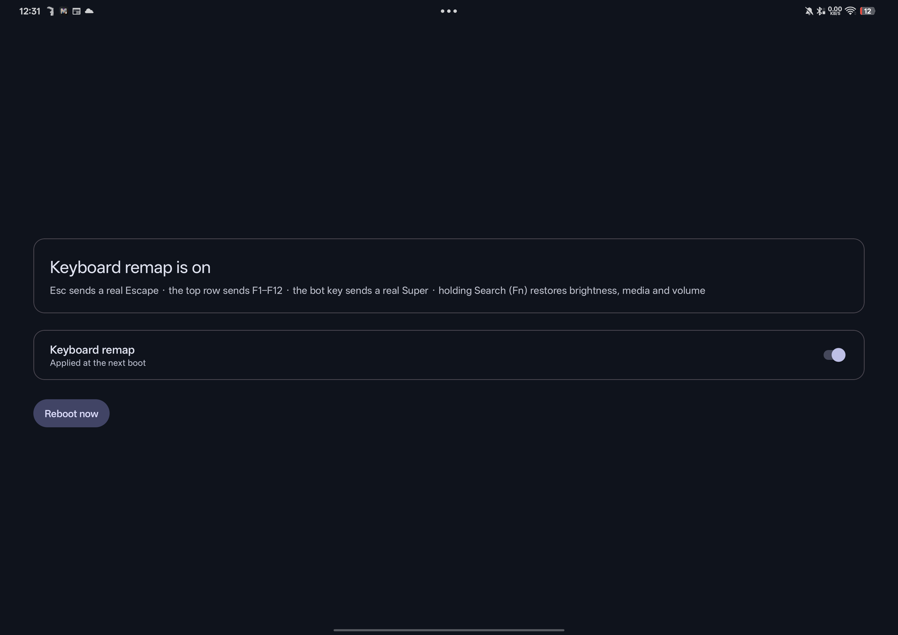

# Erhai X-11 Keyboard Remap

Makes the OnePlus Pad 3 keyboard behave the way you'd want when you're living inside Termux:X11 —
or anywhere else, honestly.



One switch. Applied at boot, so "off" means genuinely off.

| Key | Stock | Remapped |
|---|---|---|
| **Esc** | Back | **Escape** — what X sessions expect |
| **Top row** | brightness, media, volume | **F1 – F12** |
| **Search** | global search | **Fn** — hold it and the top row reverts to its original action |
| **⊞ bot key** | OnePlus gesture | **a real Super / Meta**, so your window manager shortcuts work |

## Install

1. Install `Erhai-X11-Keyboard-Remap.apk`
2. Open it and **grant root once**. The KernelSU keymap module ships *inside* the APK and installs
   itself at this point — no hunting for a zip.
3. In the **LSPosed manager**, enable **Erhai X-11 Keyboard Remap** with scope
   **System Framework**, then reboot.
   *(This step is manual on purpose — LSPosed does not let apps enable themselves, and that's a
   good boundary. The app tells you if it's still pending.)*
4. Reboot.

Flip the switch any time; it takes effect at the next boot.

**Optional:** `Erhai-X11-KeyLog.apk` shows exactly what the application layer receives for each key
press. It's how every claim below was measured, and it stays useful for adapting this to another
keyboard.

## Why two modules?

Because the two halves genuinely live at different layers:

- The **keymap** (`.kl`) decides what *key code* a physical key produces. It is global and static —
  Android reads it once when the keyboard connects. Esc and the F-row live here.
- The **hook** runs inside `system_server`, *before* Android's key-gesture layer, which is where
  OnePlus intercepts the bot key and turns it into its draw-mode gesture. Routing lives here.

A Java hook cannot change a key code, and a keymap cannot be per-app — so this uses both, each for
what it's good at.

## Limitations

Honest ones, because they're all measured rather than assumed:

- **The trackpad-toggle key can't be suppressed.** It is handled by the keyboard's own firmware:
  the key reports a *different scan code* depending on the touchpad's state (186 off / 187 on), and
  the keyboard emits `KEY_TOUCHPAD_TOGGLE` which Android doesn't even map. Nothing on the tablet can
  stop it — not the hook, not the keymap, not a kernel module. The decision never leaves the keyboard.
- **The lock and mic keys can't be restored.** Their actions only fire from real hardware events;
  re-injected events are ignored. The module therefore consumes those two keys to keep the row a
  clean F1–F12.
- **Measured on one device.** Every scan code here is the OnePlus Pad 3 keyboard (VID:PID
  `22d9:3869`), read from `/dev/input`. Another keyboard will need the same measurements redone —
  the `tools/` checkers exist to make that safe.
- **Not for Play Store distribution.** It needs root and LSPosed.

## Disclaimer

This is a personal project shared in case it's useful. It modifies keyboard behaviour on a rooted
device, using KernelSU and LSPosed. Root-level changes always carry risk: read the code, keep a
recovery path, and don't install it on hardware you can't afford to reflash.

Provided as-is, with no warranty. Not affiliated with OnePlus, OPPO, LSPosed or KernelSU.

## Credits

- **[Drun555/oneplus-meta-gate](https://github.com/Drun555/oneplus-meta-gate)** — the same problem
  solved on the same tablet, and the insight that decided this design: hook `InputManagerService`,
  not `PhoneWindowManager`, because the key-gesture layer sits between them. Its approach is a
  patched `services.jar` + bind mount; this project takes the same routing idea and does it with
  LSPosed instead.
- **[himlijnn/oplus_keyboard_free](https://github.com/himlijnn/oplus_keyboard_free)** — the
  pass-through technique for freeing the Meta key from ColorOS.
- **Android Open Source Project** — `Generic.kl`/`Generic.kcm` are the baselines the keymap is
  derived from, and the material on key layout files.
- **Material Components for Android 1.14** — the Material 3 Expressive theme and widgets.
- **LSPosed** and **KernelSU** — the two frameworks this leans on.

## Building

Built by GitHub Actions; every push to `main` refreshes the [`latest` release](../../releases/latest)
with fresh APKs. Locally: `gradle assembleDebug`.

`tools/` holds the checkers written while building this — they verify resource references, XML
well-formedness, dependency imports, and that the keymap tables stay aligned with the layout:

```sh
python3 tools/check_res.py       # resources + XML well-formedness
python3 tools/check_imports.py   # every androidx/Material import exists in its dependency
python3 tools/verify_maps.py     # the scan -> key code tables line up
python3 tools/build_keymap.py    # regenerate the .kl from a device's own Generic.kl
```
